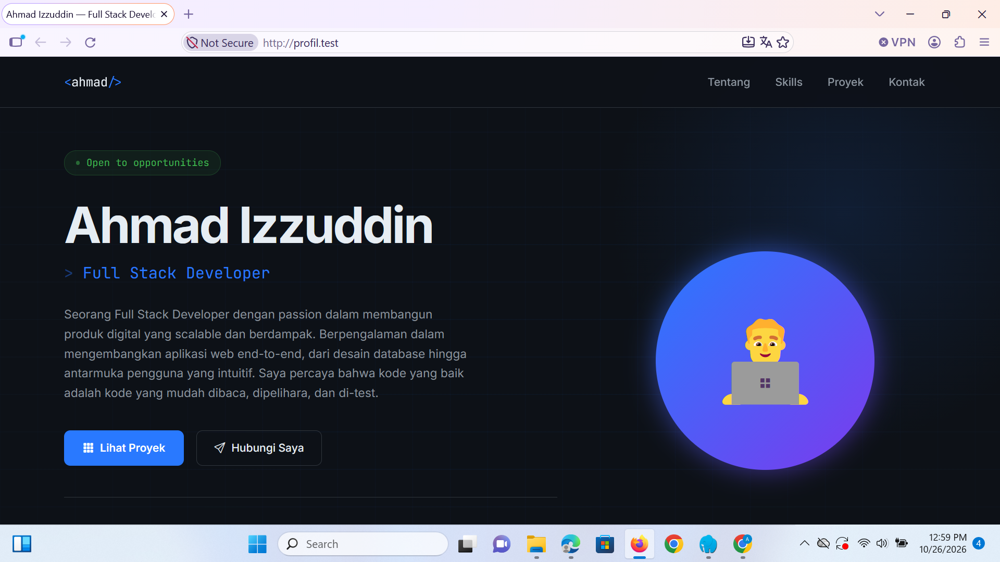

# Portfolio — Ahmad Izzuddin



## About

Portfolio website personal yang dibangun dengan **PHP Native** dan **SQLite**, tanpa framework tambahan. Menampilkan profil, keahlian, proyek, pengalaman kerja, dan form kontak yang tersimpan ke database.

Database di-generate otomatis saat pertama kali dijalankan — tidak perlu setup manual.

## Features

- Halaman profil lengkap (nama, bio, lokasi, email, GitHub, LinkedIn)
- Daftar skill dengan progress bar per kategori (Backend, Frontend, Database)
- Showcase proyek dengan tech stack, link GitHub, dan link demo
- Timeline pengalaman kerja
- Form kontak yang tersimpan ke database SQLite
- Desain responsif dark-mode dengan Bootstrap 5
- Tanpa framework PHP — murni PHP native

## Tech Stack

| Layer    | Teknologi                             |
| -------- | ------------------------------------- |
| Backend  | PHP Native                            |
| Database | SQLite (via PDO)                      |
| Frontend | Bootstrap 5, Vanilla JS               |
| Font     | Inter, JetBrains Mono (Google Fonts)  |
| Icons    | Bootstrap Icons                       |

## Struktur File
portfolio/
├── screenshoot/
│ └── Screenshot.png # Screenshot tampilan website
├── index.php # Halaman utama
├── contact.php # Endpoint POST untuk form kontak
├── db.php # Koneksi PDO + inisialisasi + seed data
├── .gitignore # Mengabaikan file .db
└── README.md


## Instalasi & Menjalankan

**Persyaratan:** PHP 7.4+ dengan ekstensi PDO dan PDO_SQLite aktif.

1. Clone repository ini:
   ```bash
   git clone https://github.com/akkuahmad/Portofolio.git
   cd Portofolio
   ```
2. Jalankan dengan PHP built-in server:
   ```bash
   php -S localhost:8000
   ```
3. Buka browser dan akses `http://localhost:8000`

File database `portfolio.db` akan otomatis dibuat dan diisi data saat pertama kali diakses.

## Kustomisasi

Untuk mengganti data profil, skill, proyek, atau pengalaman, edit fungsi `seedData()` di file `db.php`. Data akan di-reset jika file `portfolio.db` dihapus.

## Lisensi & Kontak

Proyek ini bersifat open source dan bebas digunakan sebagai referensi atau template.

**Ahmad Izzuddin**
- Email: akkuahmad23@email.com
- GitHub: [github.com/akkuahmad](https://github.com/akkuahmad)
- LinkedIn: [linkedin.com/in/akkuahmad](https://linkedin.com/in/akkuahmad)
